<h1 align="center">
  
  
  
</h1>

## 🔀 Architecture & Workflow
> 💡 A hybrid-cloud reminder app for developers working with hundreds of tabs at a time: a serverless web tier on AWS (S3, CloudFront, API Gateway, Lambda, Bedrock, DynamoDB) plus a text-to-speech server on Google Cloud, so your alarm can literally talk back.

<p align="center">
  
</p>

⌯✈︎ Main live site available at: **[deminh.com/1/](https://deminh.com/1/)**.

🌐 CloudFront live site NOT available at: **[https://d28igba62yy5is.cloudfront.net/](https://d28igba62yy5is.cloudfront.net/)** (Permanently moved).

🌏 Original live site NOT available at: **[http://reminderyoubro.s3-website-ap-southeast-2.amazonaws.com/](http://reminderyoubro.s3-website-ap-southeast-2.amazonaws.com/)** (403 Forbidden - OAC established).

<p align="center">
  
  
</p>

## 🧰 Tech stack

<p align="center">
  &nbsp;&nbsp;
  &nbsp;&nbsp;
  &nbsp;&nbsp;
  &nbsp;&nbsp;
  &nbsp;&nbsp;
  &nbsp;&nbsp;
  
  <br>
  &nbsp;&nbsp;
  &nbsp;&nbsp;
  &nbsp;&nbsp;
  &nbsp;&nbsp;
  &nbsp;&nbsp;
  &nbsp;&nbsp;
  &nbsp;&nbsp;
  
</p>

<p align="center">
  
  
</p>

## ✨ Features

- ⏰ Set an alarm by entering a time and a reminder message.
- 🎙️ Two modes: **Original** (classic alarm, no TTS) and **Special** (the alarm is spoken by a GCP text-to-speech server).
- 💾 Reminder first, audio second: the reminder is saved to DynamoDB before any TTS call, so a VM failure can never lose it.
- 🛟 Graceful degradation: if audio is still PENDING after 60s or generation fails, the alarm fires with the original sound.
- 🔒 No double-firing: each due reminder is claimed with a conditional write (PENDING → DONE), so overlapping polls can't trigger it twice.
- ⏱️ Short polling every 15s invokes Lambda to check for due reminders.
- 🪙 Daily token cap lives in SSM Parameter Store (cached 60s in Lambda), usage is tracked in DynamoDB, and both are checked before every Bedrock call. Change the cap without redeploying. When it runs out, wait until the next day.
- 💬 Cost control: chit-chat gets zero-token canned replies, so Bedrock only sees real tasks.
- 📈 Observability: CloudWatch monitors the Lambda, and an alarm only emails me (via SNS) when something breaks.
- ❌ Missed alarms are caught by an EventBridge-triggered sweeper and reported to me (admin).
- 🏗️ Infrastructure is fully managed as code (Terraform) and deployed automatically (GitHub Actions).
- ☁️ Hybrid architecture: AWS serverless website + GCP TTS server.

<p align="center">
  
  
</p>

## 🏗️ How it works

1️⃣ Open the web app (served from S3 through CloudFront, DNS/TLS via Cloudflare) and enter a time and a reminder message.

2️⃣ The app calls API Gateway, which routes the request to Lambda. Lambda first checks the daily token cap (SSM Parameter Store, cached 60s, plus usage in DynamoDB). Small talk gets a canned reply; real tasks go to Amazon Bedrock to be parsed.

3️⃣ Lambda saves the reminder to DynamoDB as PENDING.

4️⃣ In Special mode, Lambda sends the alarm text to the TTS server on a GCP VM (Nginx reverse proxy → Supertonic ONNX). The WAV is uploaded to S3 and served through CloudFront (OAC). The audio status is updated by reminder ID.

5️⃣ Every 15 seconds, the frontend polls API Gateway. Lambda looks for due reminders, claims each one with a conditional write (PENDING → DONE), and returns it with the audio link. If audio isn't ready after 60s, the original alarm sound plays instead.

6️⃣ An EventBridge Scheduler runs every 2 minutes and invokes a Lambda sweeper to find late PENDING reminders.

7️⃣ CloudWatch watches the Lambda. When its alarm fires, or the sweeper finds something missing, SNS emails me. No errors, no email.

<p align="center">
  
  
</p>

## 🔐 Security

> 🛡️ All security configuration (least-privilege IAM roles, S3 access policies via OAC, Bedrock invoke permissions, SSM parameter access, etc.) is defined in Terraform and applied automatically through GitHub Actions. Buckets are private and only reachable through CloudFront.

<p align="center">
  
  
</p>

## 📁 Project structure

```
.
├── web/                # 🌐 Static web UI (S3)
├── private/            # ⚡ serverless functions and 🧱 IaC, not available in this repo
├── asset/              # 🎨 Service icons and architecture diagram
└── .github/workflows/  # 🤖 GitHub Actions pipelines
```

<p align="center">
  
  
</p>


## 🤝 Credit
This project includes <a href="https://github.com/supertone-oss-archive/supertonic">Supertone Supertonic Text-to-Speech</a>, which is used for non-profit goals.
<pre align = "center">
                                                                              
                                                                            ____________________
                                                                                  |                    |        
               ⠀⠀⠀⠀⠀⠀⠀⠀⠀⠀⠀⠀⠀⠀⠀⠀                    ⢀⡠⠔⠂⠉⠉⠉⠉⠉⠀⠒⠠⠄⡀⠀⠀⠀⠀⠀⠀⠀|⠀DEMINH DEROZAN LE⠀ |⠀⠀⠀⠀
       ⠀⠀⠀⠀⠀⠀⠀⠀⠀⠀⠀⠀⠀⠀⠀⠀⠀⠀                ⢀⡠⠔⠊⠁⠀⠀⠀⠀⠀⠀⠀⠀⠀⠀⠀⠀⠀⠉⠒⠤⡀⠀⠀⠀⠀|____________________|
       ⠀⠀⠀⠀⠀⠀⠀⠀⠀⠀⠀⠀⠀⠀⠀⠀⢠⠔⠁⠀⠀⠀⠀⠀⠀⠀⠀⠀⠀⠀⠀⠀⠀⠀⠀⠀⠀⠀⠀⠈⢆⠀⠀⠀⠀⠀⠀⠀⠀
       ⠀⠀⠀⠀⠀⠀⠀⠀⠀⠀⠀⠀⠀⠀⠀⢠⠃⠀⠀⠀⠀⠀⠀⠀⠀⣀⣀⠀⠤⠤⠒⣂⣈⣉⣁⣀⣄⠀⠀⠀⠀⠇⠀⠀⠀⠀⠀⠀⠀
       ⠀⠀⠀⠀⠀⠀⠀⠀⠀⠀⠀⠀⠀⠀⢠⠃⠀⠀⠀⢀⡠⠄⢒⣊⣉⣀⠤⠐⠒⠉⣁⡀⠤⠒⠒⠠⣄⠀⠀⠀⠀⢸⡀⠀⠀⠀⠀⠀⠀
       ⠀⠀⠀⠀⠀⠀⠀⠀⠀⠀⠀⠀⠀⢀⡇⠠⠔⣂⡭⢅⣒⡈⠁⠠⠤⠒⠒⠈⠉⠉⠀⠀⠀⠀⠀⠀⠀⠀⠀⠀⠀⢸⡁⠀⠀⠀⠀⠀⠀
       ⠀⠀⠀⠀⠀⠀⠀⠀⠀⠀⠀⠀⠀⢸⠁⠀⠀⠀⠋⠁⠀⠀⠀⠀⠀⠀⠀⠀⠀⠀⠖⠒⠂⠉⠉⠉⠉⠲⠀⠀⠀⠈⡇⠀⠀⠀⠀⠀⠀
       ⠀⠀⠀⠀⠀⠀⠀⠀⠀⠀⠀⠀⠀⢨⡇⠀⠀⠀⠀⠀⣀⣀⣀⡀⠀⠀⠀⠀⠀⠀⠀⡀⠀⠀⠀⠀⠀⠀⠀⠀⠀⠀⣇⠀⠀⠀⠀⠀⠀
       ⠀⠀⠀⠀⠀⠀⠀⠀⠀⠀⠀⠀⠀⠀⢇⠀⢀⡔⠊⠁⠀⠀⢀⣀⠱⠀⠀⢠⠀⣰⡯⢤⣶⣶⢲⠀⠀⠀⠀⠀⠀⠀⠻⠀⠀⠀⠀⠀⠀
       ⠀⠀⠀⠀⠀⠀⠀⠀⠀⠀⠀⠀⠀⠀⠸⡀⠀⠀⠀⡔⢲⣶⣶⠨⣭⡇⠀⢸⡄⠉⠃⠚⠛⠋⠉⠀⠀⠀⠀⠀⠀⠀⢸⠀⠀⠀⠀⠀⠀
    -THANKS!-        ⠀⠀⠀⣇⠀⠀⠀⠑⠚⠻⠛⠒⠁⣧⠀⠈⢇⠀⠀⠀⠀⠀⠀⠀⠀⠀⠀⠀⠀⠀⢸⡆⠀⠀⠀⠀⠀
       ⢀⣀⡀⠀⠀⠀⠀⠀⠀⠀⠀⠀⠀⠀⠀⢸⠀⠀⠀⠀⠀⠀⠀⠀⠀⢸⠀⠀⠘⡄⠀⠀⠀⠀⠀⠀⠀⠀⠀⠀⠀⠀⢸⠁⠀⠀⠀⠀⠀
       ⠘⠦⣉⠒⠒⠲⢄⡀⠀⠀⠀⠀⠀⠀⠀⠀⡇⠀⠀⠀⠀⠀⠀⠀⢠⠏⠀⠀⠀⠈⢣⠀⠀⠀⠀⠀⠀⠀⠀⠀⠀⠀⣞⠀⠀⠀⠀⠀⠀
       ⠀⠀⢸⠁⠀⠀⠀⠈⠉⠑⠂⠠⠤⣀⣀⡀⢹⡀⠀⠀⠀⠀⠀⠀⠙⣄⢀⡤⠤⠤⠟⠁⠀⠀⠀⠀⠀⠀⠀⠀⢠⢲⠟⡆⠀⠀⠀⠀⠀
       ⠀⢀⡞⠀⠀⠀⠀⠀⠀⠀⠀⠀⠀⠀⠀⠀⠈⢧⡆⡀⠀⠀⠀⠀⠀⡈⢠⣤⡀⠀⡄⠀⠀⠀⠀⠀⠀⠀⢀⡖⣮⡿⣧⡘⠄⣀⠀⠀⠀
       ⠀⠸⠦⠤⠢⢄⡀⠀⠀⠀⠀⠀⠀⠀⠀⠀⠀⠈⢳⡏⠀⠀⠀⢠⡞⢀⣾⣅⣁⣀⡁⠈⣦⡀⢠⡀⠀⢰⣟⣿⣿⢻⣃⠀⠀⠀⠈⠑⠲
       ⠀⠀⠀⠀⠀⠀⠈⠐⢄⠀⠀⠀⠀⠀⠀⠀⠀⠀⠀⠙⣦⡆⢠⣛⠀⣾⣿⣿⣿⣿⣿⣦⣀⠋⢸⣴⢴⡃⠿⣽⢯⠢⡽⠀⠀⠀⠀⠀⠀
       ⠀⠀⠀⠀⠀⠀⠀⠀⠀⠑⠢⡀⠀⠀⠀⠀⠀⠀⠀⠀⠜⢷⣯⡿⣎⢿⣿⣿⣿⣿⣿⢟⡇⠀⠀⡿⠘⢙⡼⡿⠖⠀⠀⠀⠀⠀⠀⠀⠀
       ⠀⠀⠀⠀⠀⠀⠀⠀⠀⠀⠀⠈⠣⡀⠀⠀⠀⠀⠀⠀⠀⠼⠿⣇⡇⠈⢏⡛⠛⠛⡡⠊⠀⠀⠀⢠⣠⡯⣽⠃⠀⠀⠀⠀⠀⠀⠀⠀⠀
       ⠀⠀⠀⠀⠀⠀⠀⠀⠀⠀⠀⠀⠀⠈⠢⡀⠀⠀⠀⠀⠀⠀⠀⠹⣿⠆⡀⠀⠈⠁⠀⠀⠀⠀⢀⡴⡿⡁⠁⠀⠀⠀⠀⠀⠀⠀⠀⠀⠀
       ⠀⠀⠀⠀⠀⠀⠀⠀⠀⠀⠀⠀⠀⠀⠀⠸⡀⠀⠀⠀⠀⠀⠀⠀⠹⡷⢾⣀⡀⠀⢀⡆⣆⢀⣾⣹⡇⠀⠀⠀⠀⠀⠀⠀⠀⠀⠀⠀⠀
       ⠀⠀⠀⠀⠀⠀⠀⠀⠀⠀⠀⠀⠀⠀⠀⠀⠈⠢⣀⠀⠀⠀⠀⠀⠀⠁⠀⠉⢻⣞⠻⡇⡟⠻⡥⠀⠀⠀⠀⠀⠀⠀⠀⠀⠀⠀⠀⠀⠀
       ⠀⠀⠀⠀⠀⠀⠀⠀⠀⠀⠀⠀⠀⠀⠀⠀⠀⠀⠀⠢⡀⠀⠀⠀⠀⠀⠀⠀⠀⠈⠀⠀⠀⠀⠀⠀⠀⠀⠀⠀⠀⠀⠀⠀⠀⠀⠀⠀⠀
       ⠀⠀⠀⠀⠀⠀⠀⠀⠀⠀⠀⠀⠀⠀⠀⠀⠀⠀⠀⠀⢣⠀⠀⠀⠀⠀⠀⠀⠀⠀⠀⠀⠀⠀⠀⠀⠀⠀⠀⠀⠀⠀⠀⠀⠀⠀⠀⠀⠀
       ⠀⠀⠀⠀⠀⠀⠀⠀⠀⠀⠀⠀⠀⠀⠀⠀⠀⠀⠀⠀⢸⠀⠀⠀⠀⠀⠀⠀⠀⠀⠀⠀⠀⠀⠀⠀⠀⠀⠀⠀⠀⠀⠀⠀⠀⠀⠀⠀⠀
       ⠀⠀⠀⠀⠀⠀⠀⠀⠀⠀⠀⠀⠀⠀⠀⠀⠀⠀⠀⠀⠈⢇⠀⠀⠀⠀⠀⠀⠀⠀⠀⠀⠀⠀⠀⠀⠀⠀⠀⠀⠀⠀⠀⠀⠀⠀⠀⠀⠀
       ⠀⠀⠀⠀⠀⠀⠀⠀⠀⠀⠀⠀⠀⠀⠀⠀⠀⠀⠀⠀⠀⠈⣆⠀⠀⠀⠀⠀⠀⠀⠀⠀⠀⠀⠀⠀⠀⠀⠀⠀⠀⠀⠀⠀⠀⠀⠀⠀⠀
       ⠀⠀⠀⠀⠀⠀⠀⠀⠀⠀⠀⠀⠀⠀⠀⠀⠀⠀⠀⠀⠀⠀⠈⡄⠀⠀⠀⠀⠀⠀⠀⠀⠀⠀⠀⠀⠀⠀⠀⠀⠀⠀⠀⠀⠀⠀⠀⠀⠀
       ⠀⠀⠀⠀⠀⠀⠀⠀⠀⠀⠀⠀⠀⠀⠀⠀⠀⠀⠀⠀⠀⠀⠀⢡⠀⠀⠀⠀⠀⠀⠀⠀⠀⠀⠀⠀⠀⠀⠀⠀⠀⠀⠀⠀⠀⠀⠀⠀⠀
       ⠀⠀⠀⠀⠀⠀⠀⠀⠀⠀⠀⠀⠀⠀⠀⠀⠀⠀⠀⠀⠀⠀⠀⠸⡆⠀⠀⠀⠀⠀⠀⠀⠀⠀⠀⠀⠀⠀⠀⠀⠀⠀⠀⠀⠀⠀⠀⠀⠀
       ⠀⠀⠀⠀⠀⠀⠀⠀⠀⠀⠀⠀⠀⠀⠀⠀⠀⠀⠀⠀⠀⠀⠀⠀⡇⠀⠀⠀⠀⠀⠀⠀⠀⠀⠀⠀⠀⠀⠀⠀⠀⠀⠀⠀⠀⠀⠀⠀⠀
       ⠀⠀⠀⠀⠀⠀⠀⠀⠀⠀⠀⠀⠀⠀⠀⠀⠀⠀⠀⠀⠀⠀⠀⠀⢸⠀⠀⠀⠀⠀⠀⠀⠀⠀⠀⠀⠀⠀⠀⠀⠀⠀⠀⠀⠀⠀⠀⠀⠀
       ⠀⠀⠀⠀⠀⠀⠀⠀⠀⠀⠀⠀⠀⠀⠀⠀⠀⠀⠀⠀⠀⠀⠀⠀⠸⡄⠀⠀⠀⠀⠀⠀⠀⠀⠀⠀⠀⠀⠀⠀⠀⠀⠀⠀⠀⠀⠀⠀⠀
       ⠀⠀⠀⠀⠀⠀⠀⠀⠀⠀⠀⠀⠀⠀⠀⠀⠀⠀⠀⠀⠀⠀⠀⠀⠀⡇⠀⠀⠀⠀⠀⠀⠀⠀⠀⠀⠀⠀⠀⠀⠀⠀⠀⠀⠀⠀⠀⠀⠀
       ⠀⠀⠀⠀⠀⠀⠀⠀⠀⠀⠀⠀⠀⠀⠀⠀⠀⠀⠀⠀⠀⠀⠀⠀⠀⢿⠀⠀⠀⠀⠀⠀⠀⠀⠀⠀⠀⠀⠀⠀⠀⠀⠀⠀⠀⠀⠀⠀⠀
       ⠀⠀⠀⠀⠀⠀⠀⠀⠀⠀⠀⠀⠀⠀⠀⠀⠀⠀⠀⠀⠀⠀⠀⠀⠀⢸⠀⠀⠀⠀⠀⠀⠀⠀⠀⠀⠀⠀⠀⠀⠀⠀⠀⠀⠀⠀⠀⠀⠀
       ⠀⠀⠀⠀⠀⠀⠀⠀⠀⠀⠀⠀⠀⠀⠀⠀⠀⠀⠀⠀⠀⠀⠀⠀⠀⢸⠀⠀⠀⠀⠀⠀⠀⠀⠀⠀⠀⠀⠀⠀⠀⠀⠀⠀⠀⠀⠀⠀⠀
       ⠀⠀⠀⠀⠀⠀⠀⠀⠀⠀⠀⠀⠀⠀⠀⠀⠀⠀⠀⠀⠀⠀⠀⠀⠀⢸⠀⠀⠀⠀⠀⠀⠀⠀⠀⠀⠀⠀⠀⠀⠀⠀⠀⠀⠀⠀⠀⠀⠀
       ⠀⠀⠀⠀⠀⠀⠀⠀⠀⠀⠀⠀⠀⠀⠀⠀⠀⠀⠀⠀⠀⠀⠀⠀⠀⣿⠀⠀⠀⠀⠀⠀⠀⠀⠀⠀⠀⠀⠀⠀⠀⠀⠀⠀⠀⠀⠀⠀⠀
       ⠀⠀⠀⠀⠀⠀⠀⠀⠀⠀⠀⠀⠀⠀⠀⠀⠀⠀⠀⠀⠀⠀⠀⠀⠀⡏⠀⠀⠀⠀⠀⠀⠀⠀⠀⠀⠀⠀⠀⠀⠀⠀⠀⠀⠀⠀⠀⠀⠀
       ⠀⠀⠀⠀⠀⠀⠀⠀⠀⠀⠀⠀⠀⠀⠀⠀⠀⠀⠀⠀⠀⠀⠀⠀⣸⡄⠀⠀⠀⠀⠀⠀⠀⠀⠀⠀⠀⠀⠀⠀⠀⠀⠀⠀⠀⠀⠀⠀⠀
</pre>
                                                                              
