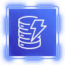

# 🦘 FunReminder - Your Aussie Reminder

A fun alarm app: enter a **time** and a **reminder message**, and when the time comes, FunReminder goes off with your reminder plus an iconic Aussie sound.

Live site available at: https://d28igba62yy5is.cloudfront.net/

## 🧰 Tech stack

<p>
  &nbsp;&nbsp;&nbsp;&nbsp;&nbsp;&nbsp;
  &nbsp;&nbsp;&nbsp;&nbsp;&nbsp;&nbsp;
  &nbsp;&nbsp;&nbsp;&nbsp;&nbsp;&nbsp;
  &nbsp;&nbsp;&nbsp;&nbsp;&nbsp;&nbsp;
  &nbsp;&nbsp;&nbsp;&nbsp;&nbsp;&nbsp;
  &nbsp;&nbsp;&nbsp;&nbsp;&nbsp;&nbsp;
  &nbsp;&nbsp;&nbsp;&nbsp;&nbsp;&nbsp;
  &nbsp;&nbsp;&nbsp;&nbsp;&nbsp;&nbsp;
  &nbsp;&nbsp;&nbsp;&nbsp;&nbsp;&nbsp;
  
</p>
 


## ✨ Features

- Set an alarm by entering a time and a reminder message.
- When the alarm fires, it will play a iconic Aussie sound.
- Infrastructure is fully managed as code (Terraform) and deployed automatically (GitHub Actions).
- Serverless architecture with no servers to manage.

## 🏗️ How it works

1. Opens the web app and enters a time and a reminder message.
2. The app calls API Gateway, which routes to Lambda to call Bedrock to process message and save in DynamoDB (including time)
3. EventBridge will scan the database every minute to check and trigger Lambda
4. Lambda reads the message from DynamoDB and send message and sound back to user sessions
5. The alarm goes off with the reminder message and sound.

## 🔐 Security

All security configuration (least-privilege IAM roles, S3 access policies, Bedrock invoke permissions, etc.) is defined in Terraform and applied automatically through GitHub Actions.

## 📁 Project structure

```
.
├── web/          # Static web UI (deployed to S3)
├── lambda/            # serverless functions
├── terraform/         # IaC
├── asset/            # Service icons
└── .github/workflows/ # GitHub Actions pipelines
```