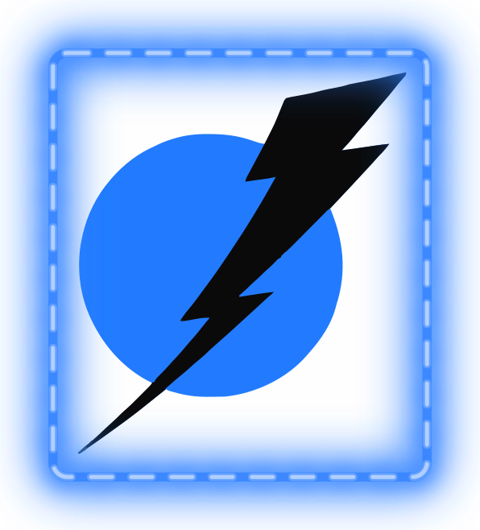

<h1 align="center">
  
  Fun Reminder: Your Aussie Bell-Ringer
  
</h1>

<p align="center">
  
</p>

<p align="center">
  
  
  
  
</p>

> 💡 A serverless web application running based on S3 and delivering content via CloudFront CDN, using AWS services to store, process and turn messages into alarm for any developers working with hundred of tabs at a time

⌯✈︎ Main live site available at: **[deminh.com/1/](https://deminh.com/1/)**.
    
🌐 CloudFront live site available at: **[https://d28igba62yy5is.cloudfront.net/](https://d28igba62yy5is.cloudfront.net/)**.

🌏 Original live site NOT available at: **[http://reminderyoubro.s3-website-ap-southeast-2.amazonaws.com/](http://reminderyoubro.s3-website-ap-southeast-2.amazonaws.com/)** (403 Forbidden - OAC established).

<p align="center">
  <picture>
    <source media="(prefers-color-scheme: dark)" srcset="asset/divider-dino-dark.svg">
    <source media="(prefers-color-scheme: light)" srcset="asset/divider-dino-light.svg">
    
  </picture>
</p>

## 🧰 Tech stack

<p align="center">
  &nbsp;&nbsp;
  &nbsp;&nbsp;
  &nbsp;&nbsp;
  &nbsp;&nbsp;
  &nbsp;&nbsp;
  &nbsp;&nbsp;
  
  <br>
  &nbsp;&nbsp;
  &nbsp;&nbsp;
  &nbsp;&nbsp;
  &nbsp;&nbsp;
  &nbsp;&nbsp;
  

<p align="center">
  <picture>
    <source media="(prefers-color-scheme: dark)" srcset="asset/divider-dino-dark.svg">
    <source media="(prefers-color-scheme: light)" srcset="asset/divider-dino-light.svg">
    
  </picture>
</p>

## ✨ Features

- ⏰ Set an alarm by entering a time and a reminder message.
- 🔊 When the alarm fires, it will play an iconic Aussie sound.
- ⏱️ Short polling is performed every 15s to invoke Lambda scanning.
- 🏗️ Infrastructure is fully managed as code (Terraform) and deployed automatically (GitHub Actions).
- ❌ Missing alarms will be detected by EventBridge scheduler, later reported to me (admin).
- ☁️ Serverless architecture with no servers to manage.
- 🪙 The number of messages (tokens) applied to the web app is limited everyday, you have to wait until the next day if it is unavailable.

<p align="center">
  <picture>
    <source media="(prefers-color-scheme: dark)" srcset="asset/divider-dino-dark.svg">
    <source media="(prefers-color-scheme: light)" srcset="asset/divider-dino-light.svg">
    
  </picture>
</p>

## 🏗️ How it works

1️⃣ Open the web app and enter a time and a reminder message.

2️⃣ The app calls API Gateway, which routes the request to Lambda. Lambda calls Amazon Bedrock to process the reminder message.

3️⃣ Lambda calls the TTS server running on a VM to convert the processed message into an audio alarm. Lambda retrieves the generated audio and uploads the audio information to S3, and the reminder time and message to DynamoDB.

4️⃣ Every 15 seconds, the frontend performs short polling by calling API Gateway, which invokes Lambda to check DynamoDB for any due reminders.

5️⃣ Lambda reads the due reminder and sends the reminder information, including the generated audio (on S3), back to the user's session.

6️⃣ If an alarm is missed, an EventBridge Scheduler running every 2 minutes invokes a Lambda sweeper to check for any missing records.

7️⃣ Any missing case will be reported to my email through SNS, so that I can investigate the issue.

<p align="center">
  <picture>
    <source media="(prefers-color-scheme: dark)" srcset="asset/divider-dino-dark.svg">
    <source media="(prefers-color-scheme: light)" srcset="asset/divider-dino-light.svg">
    
  </picture>
</p>

## 🔐 Security

> 🛡️ All security configuration (least-privilege IAM roles, S3 access policies, Bedrock invoke permissions, etc.) is defined in Terraform and applied automatically through GitHub Actions.

<p align="center">
  <picture>
    <source media="(prefers-color-scheme: dark)" srcset="asset/divider-dino-dark.svg">
    <source media="(prefers-color-scheme: light)" srcset="asset/divider-dino-light.svg">
    
  </picture>
</p>

## 📁 Project structure

```
.
├── web/                # 🌐 Static web UI (deployed to S3)
├── lambda/             # ⚡ serverless functions
├── terraform/          # 🧱 IaC
├── asset/              # 🎨 Service icons
└── .github/workflows/  # 🤖 GitHub Actions pipelines
```

<p align="center">
  <picture>
    <source media="(prefers-color-scheme: dark)" srcset="asset/divider-dino-dark.svg">
    <source media="(prefers-color-scheme: light)" srcset="asset/divider-dino-light.svg">
    
  </picture>
</p>

<pre align = "center">
                                                                              
                                                                            ____________________
                                                                                  |                    |        
               ⠀⠀⠀⠀⠀⠀⠀⠀⠀⠀⠀⠀⠀⠀⠀⠀                    ⢀⡠⠔⠂⠉⠉⠉⠉⠉⠀⠒⠠⠄⡀⠀⠀⠀⠀⠀⠀⠀|⠀DEMINH DEROZAN LE⠀ |⠀⠀⠀⠀
       ⠀⠀⠀⠀⠀⠀⠀⠀⠀⠀⠀⠀⠀⠀⠀⠀⠀⠀                ⢀⡠⠔⠊⠁⠀⠀⠀⠀⠀⠀⠀⠀⠀⠀⠀⠀⠀⠉⠒⠤⡀⠀⠀⠀⠀|____________________|
       ⠀⠀⠀⠀⠀⠀⠀⠀⠀⠀⠀⠀⠀⠀⠀⠀⢠⠔⠁⠀⠀⠀⠀⠀⠀⠀⠀⠀⠀⠀⠀⠀⠀⠀⠀⠀⠀⠀⠀⠈⢆⠀⠀⠀⠀⠀⠀⠀⠀
       ⠀⠀⠀⠀⠀⠀⠀⠀⠀⠀⠀⠀⠀⠀⠀⢠⠃⠀⠀⠀⠀⠀⠀⠀⠀⣀⣀⠀⠤⠤⠒⣂⣈⣉⣁⣀⣄⠀⠀⠀⠀⠇⠀⠀⠀⠀⠀⠀⠀
       ⠀⠀⠀⠀⠀⠀⠀⠀⠀⠀⠀⠀⠀⠀⢠⠃⠀⠀⠀⢀⡠⠄⢒⣊⣉⣀⠤⠐⠒⠉⣁⡀⠤⠒⠒⠠⣄⠀⠀⠀⠀⢸⡀⠀⠀⠀⠀⠀⠀
       ⠀⠀⠀⠀⠀⠀⠀⠀⠀⠀⠀⠀⠀⢀⡇⠠⠔⣂⡭⢅⣒⡈⠁⠠⠤⠒⠒⠈⠉⠉⠀⠀⠀⠀⠀⠀⠀⠀⠀⠀⠀⢸⡁⠀⠀⠀⠀⠀⠀
       ⠀⠀⠀⠀⠀⠀⠀⠀⠀⠀⠀⠀⠀⢸⠁⠀⠀⠀⠋⠁⠀⠀⠀⠀⠀⠀⠀⠀⠀⠀⠖⠒⠂⠉⠉⠉⠉⠲⠀⠀⠀⠈⡇⠀⠀⠀⠀⠀⠀
       ⠀⠀⠀⠀⠀⠀⠀⠀⠀⠀⠀⠀⠀⢨⡇⠀⠀⠀⠀⠀⣀⣀⣀⡀⠀⠀⠀⠀⠀⠀⠀⡀⠀⠀⠀⠀⠀⠀⠀⠀⠀⠀⣇⠀⠀⠀⠀⠀⠀
       ⠀⠀⠀⠀⠀⠀⠀⠀⠀⠀⠀⠀⠀⠀⢇⠀⢀⡔⠊⠁⠀⠀⢀⣀⠱⠀⠀⢠⠀⣰⡯⢤⣶⣶⢲⠀⠀⠀⠀⠀⠀⠀⠻⠀⠀⠀⠀⠀⠀
       ⠀⠀⠀⠀⠀⠀⠀⠀⠀⠀⠀⠀⠀⠀⠸⡀⠀⠀⠀⡔⢲⣶⣶⠨⣭⡇⠀⢸⡄⠉⠃⠚⠛⠋⠉⠀⠀⠀⠀⠀⠀⠀⢸⠀⠀⠀⠀⠀⠀
    -THANKS!-        ⠀⠀⠀⣇⠀⠀⠀⠑⠚⠻⠛⠒⠁⣧⠀⠈⢇⠀⠀⠀⠀⠀⠀⠀⠀⠀⠀⠀⠀⠀⢸⡆⠀⠀⠀⠀⠀
       ⢀⣀⡀⠀⠀⠀⠀⠀⠀⠀⠀⠀⠀⠀⠀⢸⠀⠀⠀⠀⠀⠀⠀⠀⠀⢸⠀⠀⠘⡄⠀⠀⠀⠀⠀⠀⠀⠀⠀⠀⠀⠀⢸⠁⠀⠀⠀⠀⠀
       ⠘⠦⣉⠒⠒⠲⢄⡀⠀⠀⠀⠀⠀⠀⠀⠀⡇⠀⠀⠀⠀⠀⠀⠀⢠⠏⠀⠀⠀⠈⢣⠀⠀⠀⠀⠀⠀⠀⠀⠀⠀⠀⣞⠀⠀⠀⠀⠀⠀
       ⠀⠀⢸⠁⠀⠀⠀⠈⠉⠑⠂⠠⠤⣀⣀⡀⢹⡀⠀⠀⠀⠀⠀⠀⠙⣄⢀⡤⠤⠤⠟⠁⠀⠀⠀⠀⠀⠀⠀⠀⢠⢲⠟⡆⠀⠀⠀⠀⠀
       ⠀⢀⡞⠀⠀⠀⠀⠀⠀⠀⠀⠀⠀⠀⠀⠀⠈⢧⡆⡀⠀⠀⠀⠀⠀⡈⢠⣤⡀⠀⡄⠀⠀⠀⠀⠀⠀⠀⢀⡖⣮⡿⣧⡘⠄⣀⠀⠀⠀
       ⠀⠸⠦⠤⠢⢄⡀⠀⠀⠀⠀⠀⠀⠀⠀⠀⠀⠈⢳⡏⠀⠀⠀⢠⡞⢀⣾⣅⣁⣀⡁⠈⣦⡀⢠⡀⠀⢰⣟⣿⣿⢻⣃⠀⠀⠀⠈⠑⠲
       ⠀⠀⠀⠀⠀⠀⠈⠐⢄⠀⠀⠀⠀⠀⠀⠀⠀⠀⠀⠙⣦⡆⢠⣛⠀⣾⣿⣿⣿⣿⣿⣦⣀⠋⢸⣴⢴⡃⠿⣽⢯⠢⡽⠀⠀⠀⠀⠀⠀
       ⠀⠀⠀⠀⠀⠀⠀⠀⠀⠑⠢⡀⠀⠀⠀⠀⠀⠀⠀⠀⠜⢷⣯⡿⣎⢿⣿⣿⣿⣿⣿⢟⡇⠀⠀⡿⠘⢙⡼⡿⠖⠀⠀⠀⠀⠀⠀⠀⠀
       ⠀⠀⠀⠀⠀⠀⠀⠀⠀⠀⠀⠈⠣⡀⠀⠀⠀⠀⠀⠀⠀⠼⠿⣇⡇⠈⢏⡛⠛⠛⡡⠊⠀⠀⠀⢠⣠⡯⣽⠃⠀⠀⠀⠀⠀⠀⠀⠀⠀
       ⠀⠀⠀⠀⠀⠀⠀⠀⠀⠀⠀⠀⠀⠈⠢⡀⠀⠀⠀⠀⠀⠀⠀⠹⣿⠆⡀⠀⠈⠁⠀⠀⠀⠀⢀⡴⡿⡁⠁⠀⠀⠀⠀⠀⠀⠀⠀⠀⠀
       ⠀⠀⠀⠀⠀⠀⠀⠀⠀⠀⠀⠀⠀⠀⠀⠸⡀⠀⠀⠀⠀⠀⠀⠀⠹⡷⢾⣀⡀⠀⢀⡆⣆⢀⣾⣹⡇⠀⠀⠀⠀⠀⠀⠀⠀⠀⠀⠀⠀
       ⠀⠀⠀⠀⠀⠀⠀⠀⠀⠀⠀⠀⠀⠀⠀⠀⠈⠢⣀⠀⠀⠀⠀⠀⠀⠁⠀⠉⢻⣞⠻⡇⡟⠻⡥⠀⠀⠀⠀⠀⠀⠀⠀⠀⠀⠀⠀⠀⠀
       ⠀⠀⠀⠀⠀⠀⠀⠀⠀⠀⠀⠀⠀⠀⠀⠀⠀⠀⠀⠢⡀⠀⠀⠀⠀⠀⠀⠀⠀⠈⠀⠀⠀⠀⠀⠀⠀⠀⠀⠀⠀⠀⠀⠀⠀⠀⠀⠀⠀
       ⠀⠀⠀⠀⠀⠀⠀⠀⠀⠀⠀⠀⠀⠀⠀⠀⠀⠀⠀⠀⢣⠀⠀⠀⠀⠀⠀⠀⠀⠀⠀⠀⠀⠀⠀⠀⠀⠀⠀⠀⠀⠀⠀⠀⠀⠀⠀⠀⠀
       ⠀⠀⠀⠀⠀⠀⠀⠀⠀⠀⠀⠀⠀⠀⠀⠀⠀⠀⠀⠀⢸⠀⠀⠀⠀⠀⠀⠀⠀⠀⠀⠀⠀⠀⠀⠀⠀⠀⠀⠀⠀⠀⠀⠀⠀⠀⠀⠀⠀
       ⠀⠀⠀⠀⠀⠀⠀⠀⠀⠀⠀⠀⠀⠀⠀⠀⠀⠀⠀⠀⠈⢇⠀⠀⠀⠀⠀⠀⠀⠀⠀⠀⠀⠀⠀⠀⠀⠀⠀⠀⠀⠀⠀⠀⠀⠀⠀⠀⠀
       ⠀⠀⠀⠀⠀⠀⠀⠀⠀⠀⠀⠀⠀⠀⠀⠀⠀⠀⠀⠀⠀⠈⣆⠀⠀⠀⠀⠀⠀⠀⠀⠀⠀⠀⠀⠀⠀⠀⠀⠀⠀⠀⠀⠀⠀⠀⠀⠀⠀
       ⠀⠀⠀⠀⠀⠀⠀⠀⠀⠀⠀⠀⠀⠀⠀⠀⠀⠀⠀⠀⠀⠀⠈⡄⠀⠀⠀⠀⠀⠀⠀⠀⠀⠀⠀⠀⠀⠀⠀⠀⠀⠀⠀⠀⠀⠀⠀⠀⠀
       ⠀⠀⠀⠀⠀⠀⠀⠀⠀⠀⠀⠀⠀⠀⠀⠀⠀⠀⠀⠀⠀⠀⠀⢡⠀⠀⠀⠀⠀⠀⠀⠀⠀⠀⠀⠀⠀⠀⠀⠀⠀⠀⠀⠀⠀⠀⠀⠀⠀
       ⠀⠀⠀⠀⠀⠀⠀⠀⠀⠀⠀⠀⠀⠀⠀⠀⠀⠀⠀⠀⠀⠀⠀⠸⡆⠀⠀⠀⠀⠀⠀⠀⠀⠀⠀⠀⠀⠀⠀⠀⠀⠀⠀⠀⠀⠀⠀⠀⠀
       ⠀⠀⠀⠀⠀⠀⠀⠀⠀⠀⠀⠀⠀⠀⠀⠀⠀⠀⠀⠀⠀⠀⠀⠀⡇⠀⠀⠀⠀⠀⠀⠀⠀⠀⠀⠀⠀⠀⠀⠀⠀⠀⠀⠀⠀⠀⠀⠀⠀
       ⠀⠀⠀⠀⠀⠀⠀⠀⠀⠀⠀⠀⠀⠀⠀⠀⠀⠀⠀⠀⠀⠀⠀⠀⢸⠀⠀⠀⠀⠀⠀⠀⠀⠀⠀⠀⠀⠀⠀⠀⠀⠀⠀⠀⠀⠀⠀⠀⠀
       ⠀⠀⠀⠀⠀⠀⠀⠀⠀⠀⠀⠀⠀⠀⠀⠀⠀⠀⠀⠀⠀⠀⠀⠀⠸⡄⠀⠀⠀⠀⠀⠀⠀⠀⠀⠀⠀⠀⠀⠀⠀⠀⠀⠀⠀⠀⠀⠀⠀
       ⠀⠀⠀⠀⠀⠀⠀⠀⠀⠀⠀⠀⠀⠀⠀⠀⠀⠀⠀⠀⠀⠀⠀⠀⠀⡇⠀⠀⠀⠀⠀⠀⠀⠀⠀⠀⠀⠀⠀⠀⠀⠀⠀⠀⠀⠀⠀⠀⠀
       ⠀⠀⠀⠀⠀⠀⠀⠀⠀⠀⠀⠀⠀⠀⠀⠀⠀⠀⠀⠀⠀⠀⠀⠀⠀⢿⠀⠀⠀⠀⠀⠀⠀⠀⠀⠀⠀⠀⠀⠀⠀⠀⠀⠀⠀⠀⠀⠀⠀
       ⠀⠀⠀⠀⠀⠀⠀⠀⠀⠀⠀⠀⠀⠀⠀⠀⠀⠀⠀⠀⠀⠀⠀⠀⠀⢸⠀⠀⠀⠀⠀⠀⠀⠀⠀⠀⠀⠀⠀⠀⠀⠀⠀⠀⠀⠀⠀⠀⠀
       ⠀⠀⠀⠀⠀⠀⠀⠀⠀⠀⠀⠀⠀⠀⠀⠀⠀⠀⠀⠀⠀⠀⠀⠀⠀⢸⠀⠀⠀⠀⠀⠀⠀⠀⠀⠀⠀⠀⠀⠀⠀⠀⠀⠀⠀⠀⠀⠀⠀
       ⠀⠀⠀⠀⠀⠀⠀⠀⠀⠀⠀⠀⠀⠀⠀⠀⠀⠀⠀⠀⠀⠀⠀⠀⠀⢸⠀⠀⠀⠀⠀⠀⠀⠀⠀⠀⠀⠀⠀⠀⠀⠀⠀⠀⠀⠀⠀⠀⠀
       ⠀⠀⠀⠀⠀⠀⠀⠀⠀⠀⠀⠀⠀⠀⠀⠀⠀⠀⠀⠀⠀⠀⠀⠀⠀⣿⠀⠀⠀⠀⠀⠀⠀⠀⠀⠀⠀⠀⠀⠀⠀⠀⠀⠀⠀⠀⠀⠀⠀
       ⠀⠀⠀⠀⠀⠀⠀⠀⠀⠀⠀⠀⠀⠀⠀⠀⠀⠀⠀⠀⠀⠀⠀⠀⠀⡏⠀⠀⠀⠀⠀⠀⠀⠀⠀⠀⠀⠀⠀⠀⠀⠀⠀⠀⠀⠀⠀⠀⠀
       ⠀⠀⠀⠀⠀⠀⠀⠀⠀⠀⠀⠀⠀⠀⠀⠀⠀⠀⠀⠀⠀⠀⠀⠀⣸⡄⠀⠀⠀⠀⠀⠀⠀⠀⠀⠀⠀⠀⠀⠀⠀⠀⠀⠀⠀⠀⠀⠀⠀
</pre>
                                                                              
