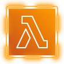
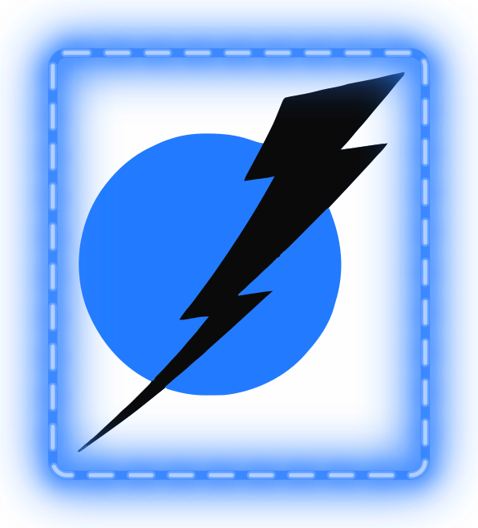

<h1 align="center">
  
  
  
</h1>

## 🔀 Architecture & Workflow
> 💡 A hybrid-cloud reminder app for developers working with hundreds of tabs at a time: a serverless web tier on AWS (S3, CloudFront, API Gateway, Lambda, Bedrock, DynamoDB) plus a text-to-speech server on Google Cloud, so your alarm can literally talk back. Around it sits a small security lab on Azure that watches the app's own logs: Elasticsearch, Kibana, Sigma detection rules and n8n automation.

<p align="center">
  
</p>

⌯✈︎ Main live site available at: **[deminh.com/1/](https://deminh.com/1/)**.

🌐 CloudFront live site NOT available at: **[https://d28igba62yy5is.cloudfront.net/](https://d28igba62yy5is.cloudfront.net/)** (Permanently moved).

🌏 Original live site NOT available at: **[http://reminderyoubro.s3-website-ap-southeast-2.amazonaws.com/](http://reminderyoubro.s3-website-ap-southeast-2.amazonaws.com/)** (403 Forbidden - OAC established).

<p align="center">
  
  
</p>

## 🧰 Tech stack

<p align="center">
  &nbsp;&nbsp;
  &nbsp;&nbsp;
  &nbsp;&nbsp;
  &nbsp;&nbsp;
  &nbsp;&nbsp;
  &nbsp;&nbsp;
  
  <br>
  &nbsp;&nbsp;
  &nbsp;&nbsp;
  &nbsp;&nbsp;
  &nbsp;&nbsp;
  &nbsp;&nbsp;
  &nbsp;&nbsp;
  &nbsp;&nbsp;
  
</p>

<p align="center"><sub>Identity, security monitoring and automation</sub></p>

<p align="center">
  &nbsp;
  &nbsp;
  &nbsp;
  &nbsp;
  &nbsp;
  &nbsp;
  &nbsp;
  &nbsp;
  &nbsp;
  &nbsp;
  
</p>

<p align="center">
  
  
</p>

## ✨ Features

- ⏰ Set an alarm by entering a time and a reminder message.
- 🎙️ Two modes: **Original** (classic alarm, no TTS) and **Special** (the alarm is spoken by a GCP text-to-speech server).
- 💾 Reminder first, audio second: the reminder is saved to DynamoDB before any TTS call, so a VM failure can never lose it.
- 🛟 Graceful degradation: if audio is still PENDING after 60s or generation fails, the alarm fires with the original sound.
- 🔒 No double-firing: each due reminder is claimed with a conditional write (PENDING → DONE), so overlapping polls can't trigger it twice.
- ⏱️ Short polling every 15s invokes Lambda to check for due reminders.
- 🪙 Daily token cap lives in SSM Parameter Store (cached 60s in Lambda), usage is tracked in DynamoDB, and both are checked before every Bedrock call. Change the cap without redeploying. When it runs out, wait until the next day.
- 💬 Cost control: chit-chat gets zero-token canned replies, so Bedrock only sees real tasks.
- 📈 Observability: CloudWatch monitors the Lambda, and an alarm only emails me (via SNS) when something breaks.
- ❌ Missed alarms are caught by an EventBridge-triggered sweeper and reported to me (admin).
- 🏗️ Infrastructure is fully managed as code (Terraform) and deployed automatically (GitHub Actions).
- 🔑 Sign in with Google or Microsoft (Entra ID, OIDC) through Cognito Hosted UI with PKCE; guests get a small free quota.
- ☁️ Hybrid architecture: AWS serverless website + GCP TTS server.
- 🚨 Prompt-injection defence: three detection layers (regex, a pre-Bedrock gate, and Claude itself). Every caught injection adds a strike, and three strikes give a temporary ban stored per account on the server, so it follows the user between devices.
- 🧾 Structured security logs (ECS JSON) sent to CloudWatch. Prompt text is never logged, only a hash and a length.
- 🔎 Detection-as-code: 11 Sigma rules kept in Git ([FRSec](https://github.com/DeMinhDeRozan/FRSec)), linted and tested in CI, then deployed to Kibana's Detection Engine.
- 🤖 n8n automation: a daily LLM triage of new alerts and a weekly security report by email. Numbers come from Elasticsearch aggregations, words come from the LLM.
- 🖥️ Azure SIEM lab: Elasticsearch, Kibana and n8n in Docker on a VM that GitHub Actions (OIDC) starts and deallocates on a schedule.

<p align="center">
  
  
</p>

## 🏗️ How it works

1️⃣ Open the web app (served from S3 through CloudFront, DNS/TLS via Cloudflare) and enter a time and a reminder message.

2️⃣ The app calls API Gateway, which routes the request to Lambda. Lambda first checks the daily token cap (SSM Parameter Store, cached 60s, plus usage in DynamoDB). Small talk gets a canned reply; real tasks go to Amazon Bedrock to be parsed.

3️⃣ Lambda saves the reminder to DynamoDB as PENDING.

4️⃣ In Special mode, Lambda sends the alarm text to the TTS server on a GCP VM (Nginx reverse proxy → Supertonic ONNX). The WAV is uploaded to S3 and served through CloudFront (OAC). The audio status is updated by reminder ID.

5️⃣ Every 15 seconds, the frontend polls API Gateway. Lambda looks for due reminders, claims each one with a conditional write (PENDING → DONE), and returns it with the audio link. If audio isn't ready after 60s, the original alarm sound plays instead.

6️⃣ An EventBridge Scheduler runs every 2 minutes and invokes a Lambda sweeper to find late PENDING reminders.

7️⃣ CloudWatch watches the Lambda. When its alarm fires, or the sweeper finds something missing, SNS emails me. No errors, no email.

8️⃣ Every message is checked for prompt injection before it can create an alarm. A caught attempt is rejected (flag), adds a strike to the account, and after three strikes the account is temporarily banned. Each step writes one JSON log line to CloudWatch.

9️⃣ A cron job on the Azure VM pulls those log lines into Elasticsearch every 10 minutes (the VM pulls, nothing connects into it). Sigma rules, converted to Kibana detection rules, raise alerts.

🔟 n8n polls Elasticsearch every morning, enriches each new alert with the account's recent activity, asks an LLM for a verdict, and stores it. Every Monday it emails me a weekly security report.

<p align="center">
  
  
</p>

## 🔐 Security

> 🛡️ All security configuration (least-privilege IAM roles, S3 access policies via OAC, Bedrock invoke permissions, SSM parameter access, etc.) is defined in Terraform and applied automatically through GitHub Actions. Buckets are private and only reachable through CloudFront.

- 🧱 **Abuse prevention in the Lambda:** flag, strike and ban run at any hour, per account (per IP for guests who keep rotating IDs).
- 🔑 **Identity:** Cognito Hosted UI with PKCE, Google and Microsoft Entra ID (OIDC). Every identity becomes the same kind of account ID on the server, so bans and limits work the same for both.
- 🔒 **Locked-down SIEM:** Elasticsearch, Kibana and n8n listen on `127.0.0.1` only and are reached through an SSH tunnel. SSH accepts keys only, the VM uses a read-only IAM user to read logs, and the VM schedule signs in to Azure through OIDC with a managed identity that can manage only that one VM.
- 🙈 **Privacy by design:** prompt text is never logged, and the LLM that writes the weekly report only sees anonymous totals, never account IDs, emails or IPs.
- 🧪 **Honest limits:** this is a lab, not a production SIEM. The VM runs about 8 hours a day, so triage is not real time, while prevention in the Lambda is always on. The rules look at single events and time-window rules are not written yet.

<p align="center">
  
  
</p>

## 📁 Project structure

```
.
├── web/                # 🌐 Static web UI (S3)
├── Lambda/             # ⚡ Sanitised serverless function samples
├── private/            # 🧱 Full Lambda source and IaC, not available in this repo
├── asset/              # 🎨 Service icons and architecture diagram
└── .github/workflows/  # 🤖 GitHub Actions pipelines
```

Related repository: **[FRSec](https://github.com/DeMinhDeRozan/FRSec)** holds the Sigma detection rules, synthetic test events and the CI that deploys them to Kibana.

<p align="center">
  
  
</p>


## 🤝 Credit
This project includes <a href="https://github.com/supertone-oss-archive/supertonic">Supertone Supertonic Text-to-Speech</a>, which is used for non-profit goals.
<pre align = "center">
                                                                              
                                                                            ____________________
                                                                                  |                    |        
               ⠀⠀⠀⠀⠀⠀⠀⠀⠀⠀⠀⠀⠀⠀⠀⠀                    ⢀⡠⠔⠂⠉⠉⠉⠉⠉⠀⠒⠠⠄⡀⠀⠀⠀⠀⠀⠀⠀|⠀DEMINH DEROZAN LE⠀ |⠀⠀⠀⠀
       ⠀⠀⠀⠀⠀⠀⠀⠀⠀⠀⠀⠀⠀⠀⠀⠀⠀⠀                ⢀⡠⠔⠊⠁⠀⠀⠀⠀⠀⠀⠀⠀⠀⠀⠀⠀⠀⠉⠒⠤⡀⠀⠀⠀⠀|____________________|
       ⠀⠀⠀⠀⠀⠀⠀⠀⠀⠀⠀⠀⠀⠀⠀⠀⢠⠔⠁⠀⠀⠀⠀⠀⠀⠀⠀⠀⠀⠀⠀⠀⠀⠀⠀⠀⠀⠀⠀⠈⢆⠀⠀⠀⠀⠀⠀⠀⠀
       ⠀⠀⠀⠀⠀⠀⠀⠀⠀⠀⠀⠀⠀⠀⠀⢠⠃⠀⠀⠀⠀⠀⠀⠀⠀⣀⣀⠀⠤⠤⠒⣂⣈⣉⣁⣀⣄⠀⠀⠀⠀⠇⠀⠀⠀⠀⠀⠀⠀
       ⠀⠀⠀⠀⠀⠀⠀⠀⠀⠀⠀⠀⠀⠀⢠⠃⠀⠀⠀⢀⡠⠄⢒⣊⣉⣀⠤⠐⠒⠉⣁⡀⠤⠒⠒⠠⣄⠀⠀⠀⠀⢸⡀⠀⠀⠀⠀⠀⠀
       ⠀⠀⠀⠀⠀⠀⠀⠀⠀⠀⠀⠀⠀⢀⡇⠠⠔⣂⡭⢅⣒⡈⠁⠠⠤⠒⠒⠈⠉⠉⠀⠀⠀⠀⠀⠀⠀⠀⠀⠀⠀⢸⡁⠀⠀⠀⠀⠀⠀
       ⠀⠀⠀⠀⠀⠀⠀⠀⠀⠀⠀⠀⠀⢸⠁⠀⠀⠀⠋⠁⠀⠀⠀⠀⠀⠀⠀⠀⠀⠀⠖⠒⠂⠉⠉⠉⠉⠲⠀⠀⠀⠈⡇⠀⠀⠀⠀⠀⠀
       ⠀⠀⠀⠀⠀⠀⠀⠀⠀⠀⠀⠀⠀⢨⡇⠀⠀⠀⠀⠀⣀⣀⣀⡀⠀⠀⠀⠀⠀⠀⠀⡀⠀⠀⠀⠀⠀⠀⠀⠀⠀⠀⣇⠀⠀⠀⠀⠀⠀
       ⠀⠀⠀⠀⠀⠀⠀⠀⠀⠀⠀⠀⠀⠀⢇⠀⢀⡔⠊⠁⠀⠀⢀⣀⠱⠀⠀⢠⠀⣰⡯⢤⣶⣶⢲⠀⠀⠀⠀⠀⠀⠀⠻⠀⠀⠀⠀⠀⠀
       ⠀⠀⠀⠀⠀⠀⠀⠀⠀⠀⠀⠀⠀⠀⠸⡀⠀⠀⠀⡔⢲⣶⣶⠨⣭⡇⠀⢸⡄⠉⠃⠚⠛⠋⠉⠀⠀⠀⠀⠀⠀⠀⢸⠀⠀⠀⠀⠀⠀
    -THANKS!-        ⠀⠀⠀⣇⠀⠀⠀⠑⠚⠻⠛⠒⠁⣧⠀⠈⢇⠀⠀⠀⠀⠀⠀⠀⠀⠀⠀⠀⠀⠀⢸⡆⠀⠀⠀⠀⠀
       ⢀⣀⡀⠀⠀⠀⠀⠀⠀⠀⠀⠀⠀⠀⠀⢸⠀⠀⠀⠀⠀⠀⠀⠀⠀⢸⠀⠀⠘⡄⠀⠀⠀⠀⠀⠀⠀⠀⠀⠀⠀⠀⢸⠁⠀⠀⠀⠀⠀
       ⠘⠦⣉⠒⠒⠲⢄⡀⠀⠀⠀⠀⠀⠀⠀⠀⡇⠀⠀⠀⠀⠀⠀⠀⢠⠏⠀⠀⠀⠈⢣⠀⠀⠀⠀⠀⠀⠀⠀⠀⠀⠀⣞⠀⠀⠀⠀⠀⠀
       ⠀⠀⢸⠁⠀⠀⠀⠈⠉⠑⠂⠠⠤⣀⣀⡀⢹⡀⠀⠀⠀⠀⠀⠀⠙⣄⢀⡤⠤⠤⠟⠁⠀⠀⠀⠀⠀⠀⠀⠀⢠⢲⠟⡆⠀⠀⠀⠀⠀
       ⠀⢀⡞⠀⠀⠀⠀⠀⠀⠀⠀⠀⠀⠀⠀⠀⠈⢧⡆⡀⠀⠀⠀⠀⠀⡈⢠⣤⡀⠀⡄⠀⠀⠀⠀⠀⠀⠀⢀⡖⣮⡿⣧⡘⠄⣀⠀⠀⠀
       ⠀⠸⠦⠤⠢⢄⡀⠀⠀⠀⠀⠀⠀⠀⠀⠀⠀⠈⢳⡏⠀⠀⠀⢠⡞⢀⣾⣅⣁⣀⡁⠈⣦⡀⢠⡀⠀⢰⣟⣿⣿⢻⣃⠀⠀⠀⠈⠑⠲
       ⠀⠀⠀⠀⠀⠀⠈⠐⢄⠀⠀⠀⠀⠀⠀⠀⠀⠀⠀⠙⣦⡆⢠⣛⠀⣾⣿⣿⣿⣿⣿⣦⣀⠋⢸⣴⢴⡃⠿⣽⢯⠢⡽⠀⠀⠀⠀⠀⠀
       ⠀⠀⠀⠀⠀⠀⠀⠀⠀⠑⠢⡀⠀⠀⠀⠀⠀⠀⠀⠀⠜⢷⣯⡿⣎⢿⣿⣿⣿⣿⣿⢟⡇⠀⠀⡿⠘⢙⡼⡿⠖⠀⠀⠀⠀⠀⠀⠀⠀
       ⠀⠀⠀⠀⠀⠀⠀⠀⠀⠀⠀⠈⠣⡀⠀⠀⠀⠀⠀⠀⠀⠼⠿⣇⡇⠈⢏⡛⠛⠛⡡⠊⠀⠀⠀⢠⣠⡯⣽⠃⠀⠀⠀⠀⠀⠀⠀⠀⠀
       ⠀⠀⠀⠀⠀⠀⠀⠀⠀⠀⠀⠀⠀⠈⠢⡀⠀⠀⠀⠀⠀⠀⠀⠹⣿⠆⡀⠀⠈⠁⠀⠀⠀⠀⢀⡴⡿⡁⠁⠀⠀⠀⠀⠀⠀⠀⠀⠀⠀
       ⠀⠀⠀⠀⠀⠀⠀⠀⠀⠀⠀⠀⠀⠀⠀⠸⡀⠀⠀⠀⠀⠀⠀⠀⠹⡷⢾⣀⡀⠀⢀⡆⣆⢀⣾⣹⡇⠀⠀⠀⠀⠀⠀⠀⠀⠀⠀⠀⠀
       ⠀⠀⠀⠀⠀⠀⠀⠀⠀⠀⠀⠀⠀⠀⠀⠀⠈⠢⣀⠀⠀⠀⠀⠀⠀⠁⠀⠉⢻⣞⠻⡇⡟⠻⡥⠀⠀⠀⠀⠀⠀⠀⠀⠀⠀⠀⠀⠀⠀
       ⠀⠀⠀⠀⠀⠀⠀⠀⠀⠀⠀⠀⠀⠀⠀⠀⠀⠀⠀⠢⡀⠀⠀⠀⠀⠀⠀⠀⠀⠈⠀⠀⠀⠀⠀⠀⠀⠀⠀⠀⠀⠀⠀⠀⠀⠀⠀⠀⠀
       ⠀⠀⠀⠀⠀⠀⠀⠀⠀⠀⠀⠀⠀⠀⠀⠀⠀⠀⠀⠀⢣⠀⠀⠀⠀⠀⠀⠀⠀⠀⠀⠀⠀⠀⠀⠀⠀⠀⠀⠀⠀⠀⠀⠀⠀⠀⠀⠀⠀
       ⠀⠀⠀⠀⠀⠀⠀⠀⠀⠀⠀⠀⠀⠀⠀⠀⠀⠀⠀⠀⢸⠀⠀⠀⠀⠀⠀⠀⠀⠀⠀⠀⠀⠀⠀⠀⠀⠀⠀⠀⠀⠀⠀⠀⠀⠀⠀⠀⠀
       ⠀⠀⠀⠀⠀⠀⠀⠀⠀⠀⠀⠀⠀⠀⠀⠀⠀⠀⠀⠀⠈⢇⠀⠀⠀⠀⠀⠀⠀⠀⠀⠀⠀⠀⠀⠀⠀⠀⠀⠀⠀⠀⠀⠀⠀⠀⠀⠀⠀
       ⠀⠀⠀⠀⠀⠀⠀⠀⠀⠀⠀⠀⠀⠀⠀⠀⠀⠀⠀⠀⠀⠈⣆⠀⠀⠀⠀⠀⠀⠀⠀⠀⠀⠀⠀⠀⠀⠀⠀⠀⠀⠀⠀⠀⠀⠀⠀⠀⠀
       ⠀⠀⠀⠀⠀⠀⠀⠀⠀⠀⠀⠀⠀⠀⠀⠀⠀⠀⠀⠀⠀⠀⠈⡄⠀⠀⠀⠀⠀⠀⠀⠀⠀⠀⠀⠀⠀⠀⠀⠀⠀⠀⠀⠀⠀⠀⠀⠀⠀
       ⠀⠀⠀⠀⠀⠀⠀⠀⠀⠀⠀⠀⠀⠀⠀⠀⠀⠀⠀⠀⠀⠀⠀⢡⠀⠀⠀⠀⠀⠀⠀⠀⠀⠀⠀⠀⠀⠀⠀⠀⠀⠀⠀⠀⠀⠀⠀⠀⠀
       ⠀⠀⠀⠀⠀⠀⠀⠀⠀⠀⠀⠀⠀⠀⠀⠀⠀⠀⠀⠀⠀⠀⠀⠸⡆⠀⠀⠀⠀⠀⠀⠀⠀⠀⠀⠀⠀⠀⠀⠀⠀⠀⠀⠀⠀⠀⠀⠀⠀
       ⠀⠀⠀⠀⠀⠀⠀⠀⠀⠀⠀⠀⠀⠀⠀⠀⠀⠀⠀⠀⠀⠀⠀⠀⡇⠀⠀⠀⠀⠀⠀⠀⠀⠀⠀⠀⠀⠀⠀⠀⠀⠀⠀⠀⠀⠀⠀⠀⠀
       ⠀⠀⠀⠀⠀⠀⠀⠀⠀⠀⠀⠀⠀⠀⠀⠀⠀⠀⠀⠀⠀⠀⠀⠀⢸⠀⠀⠀⠀⠀⠀⠀⠀⠀⠀⠀⠀⠀⠀⠀⠀⠀⠀⠀⠀⠀⠀⠀⠀
       ⠀⠀⠀⠀⠀⠀⠀⠀⠀⠀⠀⠀⠀⠀⠀⠀⠀⠀⠀⠀⠀⠀⠀⠀⠸⡄⠀⠀⠀⠀⠀⠀⠀⠀⠀⠀⠀⠀⠀⠀⠀⠀⠀⠀⠀⠀⠀⠀⠀
       ⠀⠀⠀⠀⠀⠀⠀⠀⠀⠀⠀⠀⠀⠀⠀⠀⠀⠀⠀⠀⠀⠀⠀⠀⠀⡇⠀⠀⠀⠀⠀⠀⠀⠀⠀⠀⠀⠀⠀⠀⠀⠀⠀⠀⠀⠀⠀⠀⠀
       ⠀⠀⠀⠀⠀⠀⠀⠀⠀⠀⠀⠀⠀⠀⠀⠀⠀⠀⠀⠀⠀⠀⠀⠀⠀⢿⠀⠀⠀⠀⠀⠀⠀⠀⠀⠀⠀⠀⠀⠀⠀⠀⠀⠀⠀⠀⠀⠀⠀
       ⠀⠀⠀⠀⠀⠀⠀⠀⠀⠀⠀⠀⠀⠀⠀⠀⠀⠀⠀⠀⠀⠀⠀⠀⠀⢸⠀⠀⠀⠀⠀⠀⠀⠀⠀⠀⠀⠀⠀⠀⠀⠀⠀⠀⠀⠀⠀⠀⠀
       ⠀⠀⠀⠀⠀⠀⠀⠀⠀⠀⠀⠀⠀⠀⠀⠀⠀⠀⠀⠀⠀⠀⠀⠀⠀⢸⠀⠀⠀⠀⠀⠀⠀⠀⠀⠀⠀⠀⠀⠀⠀⠀⠀⠀⠀⠀⠀⠀⠀
       ⠀⠀⠀⠀⠀⠀⠀⠀⠀⠀⠀⠀⠀⠀⠀⠀⠀⠀⠀⠀⠀⠀⠀⠀⠀⢸⠀⠀⠀⠀⠀⠀⠀⠀⠀⠀⠀⠀⠀⠀⠀⠀⠀⠀⠀⠀⠀⠀⠀
       ⠀⠀⠀⠀⠀⠀⠀⠀⠀⠀⠀⠀⠀⠀⠀⠀⠀⠀⠀⠀⠀⠀⠀⠀⠀⣿⠀⠀⠀⠀⠀⠀⠀⠀⠀⠀⠀⠀⠀⠀⠀⠀⠀⠀⠀⠀⠀⠀⠀
       ⠀⠀⠀⠀⠀⠀⠀⠀⠀⠀⠀⠀⠀⠀⠀⠀⠀⠀⠀⠀⠀⠀⠀⠀⠀⡏⠀⠀⠀⠀⠀⠀⠀⠀⠀⠀⠀⠀⠀⠀⠀⠀⠀⠀⠀⠀⠀⠀⠀
       ⠀⠀⠀⠀⠀⠀⠀⠀⠀⠀⠀⠀⠀⠀⠀⠀⠀⠀⠀⠀⠀⠀⠀⠀⣸⡄⠀⠀⠀⠀⠀⠀⠀⠀⠀⠀⠀⠀⠀⠀⠀⠀⠀⠀⠀⠀⠀⠀⠀
</pre>
